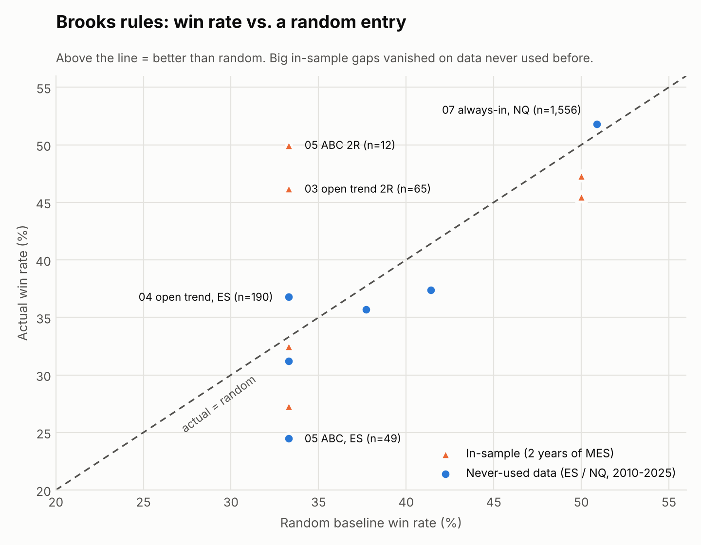
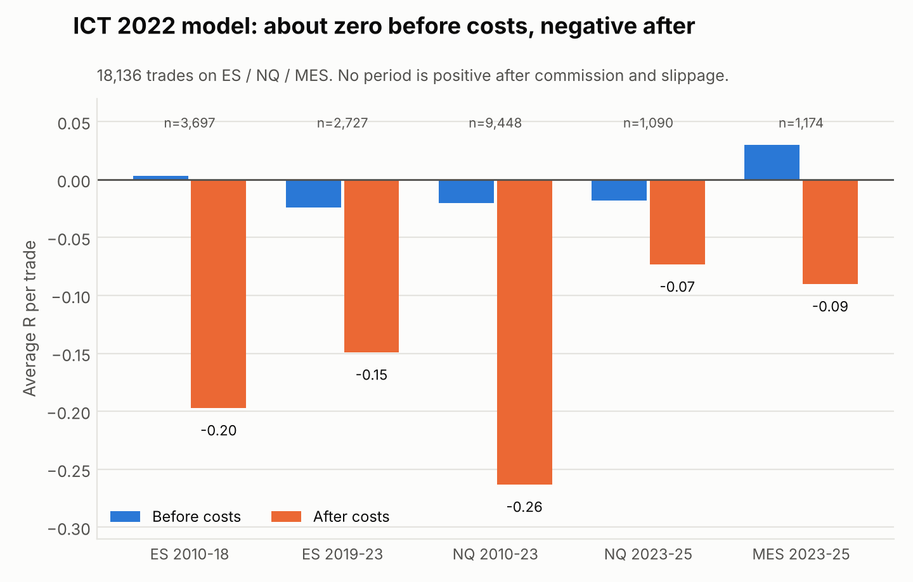

# strategy-autopsy

**English** | [日本語](README.ja.md)

**We turned trading-course strategies into code and backtested them on 15 years of futures data to see whether they actually make money.**

So far, **none of the Al Brooks price action or ICT / Smart Money Concepts (SMC) rules we tested showed a reliable edge after costs.** This repository publishes every rule, the code and the results, plus a process you can use to test your own strategy the same way.

> ⚠️ There is no profitable strategy here. This repository is for research and education only and is not investment advice.

---

## Why

Most strategies online are sold with screenshots and "high win rate" claims. Very few people fix the rules in advance, test them on long histories and publish the failures.

Our process is simple (details in [docs/method.md](docs/method.md)):

1. **Register the rules before looking at the data.** Rules, parameters and pass criteria are fixed before the backtest and never changed afterwards.
2. **Test each rule set once.** No parameter tuning on the same data.
3. **Lock out-of-sample data.** One year of MES data after 2025-09 has never been used by any experiment.
4. **Compare with a random baseline.** From each trade's stop and target distance, compute the win rate a random entry would have, and check whether the actual win rate is significantly higher.
5. **Count costs honestly.** Commission and slippage, plus a slippage sensitivity test.

---

## Results

Every row has a registry entry with the original rules, data, pass criteria and full results.

### Al Brooks price action (7 rounds, ES / MES / NQ, 2010-2025)

<picture>
  <source media="(prefers-color-scheme: dark)" srcset="docs/img/brooks_vs_random_dark.png">
  
</picture>

| # | Rule | Key result | Verdict |
|---|---|---|---|
| [01](registry/brooks-01-pullback.md) | With-trend H2/L2 pullback, target 1R / 2R / prior extreme | Win rate 47.3% / 32.5% / 27.5%, right at the random baseline of ~50% / ~33% / lower | No edge |
| [02](registry/brooks-02-refined-pullback.md) | Refined pullback: three extra conditions (trend strength, pullback momentum, entry price) | 44 trades, profit factor 0.59 / 0.61 | Fail |
| [03](registry/brooks-03-open-trend.md) | First pullback in a trend from the open (in-sample) | 65 trades, win rate 46.2%, profit factor 1.14 | Worth validating |
| [04](registry/brooks-04-open-trend-validation.md) | #03 unchanged, on new data | ES 190 trades, PF 0.91; NQ 80 trades, PF 0.82 | Fail |
| [05](registry/brooks-05-abc-pullback.md) | Structured two-leg ABC pullback | Only 49 trades in 8.5 years of ES, win rate 24.5% | Fail |
| [06](registry/brooks-06-failed-breakout-fade.md) | Fade failed breakouts on trading-range days | Win rate 37.4% / 35.7% on two ES periods, below the random baselines of 41.4% / 37.7% | Fail |
| [07](registry/brooks-07-always-in.md) | Always-in reversal (follow two strong trend bars) | 13 years of NQ, 1,556 trades, win rate 51.8% vs 50.9% baseline (z ≈ 0.7), PF 1.07 | Fail |

#07 is the only round that was positive over a long history, but its win rate is not significantly different from random, and 2 extra ticks of slippage per side bring the profit factor to 1.00.

### ICT / Smart Money Concepts (ES / NQ / MES, 2010-2025)

<picture>
  <source media="(prefers-color-scheme: dark)" srcset="docs/img/ict_r_dark.png">
  
</picture>

| # | Rule | Key result | Verdict |
|---|---|---|---|
| [01](registry/ict-01-mentorship-model.md) | 2022 Mentorship intraday model: liquidity sweep → market structure shift → enter on return to FVG | ES 6,424 trades, NQ 10,538 trades; average R before costs ≈ 0, after costs −0.18R / −0.24R | Fail |
| [02](registry/ict-02-pick-best-levels.md) | 3 entries × 3 exits per setup, upper bound if every pick is right | ICT levels have the same upper bound as random levels (difference +0.004R, t = 0.41) | Fail |
| [03](registry/ict-03-episode2-pattern.md) | Only the strict pattern from Episode 2 | 626 trades, −0.14R after costs (t = −2.55, significantly negative) | Fail |
| [04](registry/ict-04-checklist.md) | An ICT trading checklist from an online article | As written: 0 trades in 3 years; relaxed: 82 trades, −0.18R | No edge |

---

## What we learned

- **Win rate and reward:risk are not two independent dials.** For an entry with no directional information, the win rate is about `stop ÷ (stop + target)`. However you adjust them, the expectancy stays near zero and turns negative after costs.
- **The only question that matters is whether the entry signal carries directional information**, that is, whether the actual win rate is significantly above the random baseline.
- **Good in-sample results are almost always luck.** #03, #05 and #06 were all positive on two years of in-sample MES, and all failed on data they had never seen.
- **Most Smart Money concepts are price action under new names.** Stacking them adds no new information; it only leaves fewer signals.
- **A method that only works when you "see" it, and stops working once written as rules, probably has no real edge.** But note what this repository shows: these mechanical versions have no edge. It does not show that discretionary trading never works.

---

## Test your own strategy

```bash
pip install -r requirements.txt

# 0. Check that the engine is honest: on pure random-walk data every rule should lose money
python tools/random_walk.py --days 2000 --out data/random_walk.csv
python brooks/backtest.py data/random_walk.csv --symbol MES --strategy ai --target 1R --out results/random_ai
python tools/report.py results/random_ai/trades.csv --symbol MES

# 1. Write a registry entry in registry/ (template: registry/TEMPLATE.md) and commit it first
# 2. Backtest on your data, once
python brooks/backtest.py data/your_data.csv --symbol MES --strategy pullback --target 2R --out results/my_test

# 3. Report: win rate vs random baseline, z score, slippage sensitivity, by year
python tools/report.py results/my_test/trades.csv --symbol MES --out results/my_test/REPORT.md
```

The ICT model runs with `ict/research.py` (plus `research_choice.py` and `research_ep2.py`); usage is at the top of each file.

Data format: [data/README.md](data/README.md). No market data is included.

**Our own honesty check** (2,000 days of random walk, `--seed 11`):

| Strategy | Trades | Win rate | Random baseline | Profit factor |
|---|---|---|---|---|
| Brooks `ai` | 245 | 51.4% | 51.6% | 0.85 |
| Brooks `fade` | 284 | 36.3% | 38.5% | 0.79 |
| ICT intraday model (400 days) | 607 | 28% | — | −0.18R after costs, no better than mirror trades |

Win rates sit at the baseline and the strategies lose money after costs, so the engine is not looking ahead.

---

## Repository layout

```
strategy-autopsy/
├── README.md / README.ja.md
├── registry/            # rules, pass criteria and results for every experiment (registered before testing)
│   ├── TEMPLATE.md / TEMPLATE.ja.md
│   ├── brooks-01 … 07
│   └── ict-01 … 04
├── brooks/
│   ├── pa_engine.py     # Brooks pattern features (incremental, closed bars only)
│   └── backtest.py      # intraday backtest: 5-minute signals, 1-minute order matching
├── ict/
│   ├── ictlib.py        # ICT concepts: liquidity, MSS, FVG, kill zones
│   ├── research.py      # ICT-01
│   ├── research_choice.py  # ICT-02
│   └── research_ep2.py  # ICT-03
├── tools/
│   ├── report.py        # random baseline, z score, slippage sensitivity, by year
│   └── random_walk.py   # random-walk data for the honesty check
├── data/README.md       # data format (no data included)
└── docs/            # method.md / method.ja.md, img/ (figures + make_figures.py)
```

---

## Limitations

- **The rules are one objective definition of Brooks and ICT concepts.** A different definition could give different results. You are welcome to register your own definition and test it the same way.
- **The Brooks engine is the version tidied up after the experiments** (with a few filters that can be switched off individually). Rerunning with default parameters may not reproduce the registry numbers exactly.
- ICT-04 used index CFD 5-minute data, not CME futures. No experiment filtered out news or FOMC days.
- Backtests contain no discretionary judgement. Whether discretionary trading has an edge needs a different kind of test.

## Disclaimer

This repository is not investment advice. The authors are not financial advisers. Do not trade real money based on it.

MIT License
